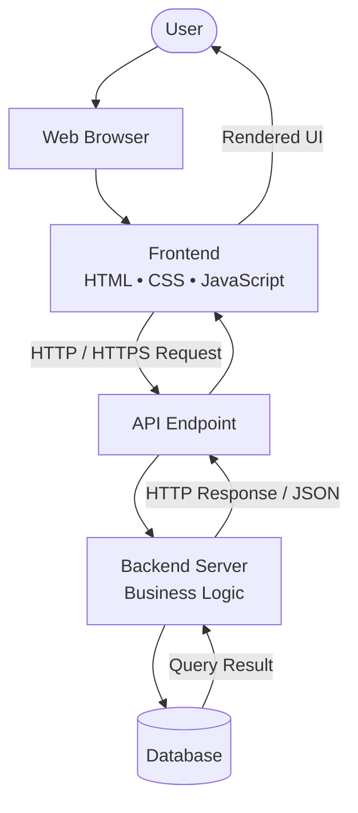
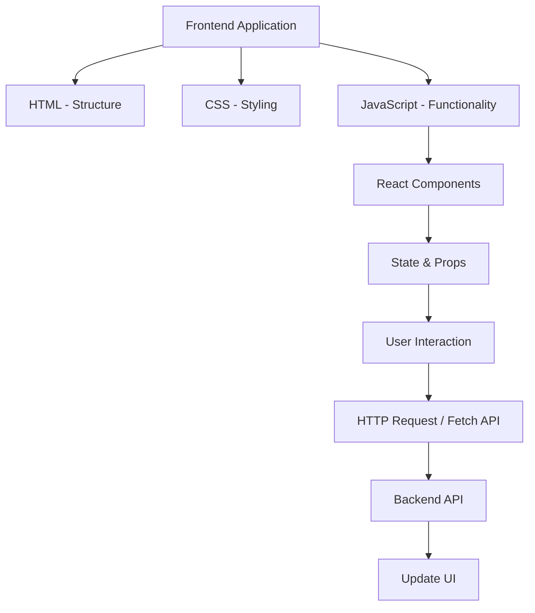
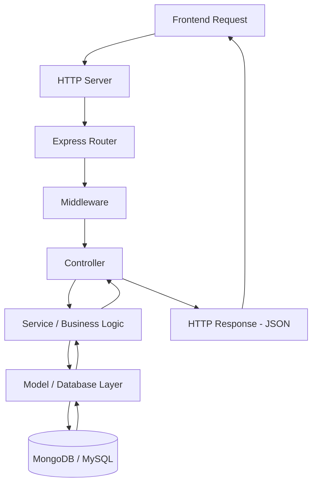
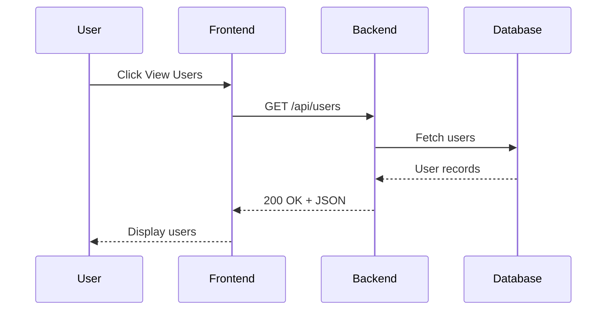

#### 1 [[html]] 
#### 2 [[css]]
#### 3 [[java script]]
#### 4 [[Git_GitHub]]
#### 5 [[React]]
#### 6 [[Backend]]
#### 7 [[Database]]
#### 8 [[Deployment]]
#### 9 [[project]]
#### 10 [[Interview Preparation]]
#### 11 [[Resources]]


# Web Development — Fundamentals & Architecture

Web development is the process of building websites and web applications. It combines frontend, backend, databases and APIs to create functional applications.

## 1. Web Application Architecture

A web application follows a client-server architecture. The client sends requests, the server processes them, and the server returns responses.



### Core Components

| Component | Responsibility |
|---|---|
| Client | Sends requests to the server |
| Frontend | Displays the user interface |
| API | Defines communication between client and server |
| Backend | Processes requests and business logic |
| Database | Stores and retrieves information |
| Server | Runs backend application code |

---

## 2. Frontend Development

Frontend is the client-side part of an application. It handles everything users see and interact with.

### Frontend Architecture



### Main Technologies

- **HTML:** Defines the structure and content of a webpage.
- **CSS:** Controls layout, colors, spacing and responsiveness.
- **JavaScript:** Adds interactivity and dynamic functionality.
- **React:** Builds reusable UI components.
- **DOM:** Represents the webpage as a tree of objects that JavaScript can interact with.

### Important Frontend Concepts

| Concept | Meaning |
|---|---|
| DOM | Document Object Model |
| Component | Reusable UI building block |
| Props | Data passed between components |
| State | Data that changes over time |
| Event Handling | Responding to user actions |
| Responsive Design | Adapting UI to screen sizes |
| Fetch API | Making HTTP requests from the browser |

---

## 3. Backend Development

Backend is the server-side part of an application. It handles requests, authentication, business logic, database operations and responses.

### Backend Architecture



### Main Backend Technologies

- **Node.js:** JavaScript runtime for executing JavaScript outside the browser.
- **Express.js:** Node.js framework for building APIs and web servers.
- **MongoDB:** NoSQL database that stores data in BSON documents.
- **Mongoose:** ODM library for working with MongoDB through schemas and models.
- **JWT:** JSON Web Token used for token-based authentication.

### Important Backend Concepts

| Concept | Meaning |
|---|---|
| Server | Receives and processes requests |
| Routing | Maps URLs and HTTP methods to handlers |
| Middleware | Functions executed during the request-response cycle |
| Controller | Handles incoming requests and sends responses |
| API | Interface for communication between applications |
| Authentication | Verifies user identity |
| Authorization | Checks user permissions |
| Validation | Checks incoming data |
| CRUD | Create, Read, Update, Delete |
| Error Handling | Manages application errors |

---

## 4. Frontend ↔ Backend Communication

Example: Fetching user data from an API.



### Example API Request

**Frontend (JavaScript)**

```javascript
const response = await fetch("/api/users");
const data = await response.json();

console.log(data);
```

**Backend (Express.js)**

```javascript
app.get("/api/users", (req, res) => {
  res.status(200).json({
    message: "Users fetched successfully"
  });
});
```

---

## 5. HTTP Methods

| Method | Purpose |
|---|---|
| GET | Retrieve data |
| POST | Create data |
| PUT | Replace existing data |
| PATCH | Partially update data |
| DELETE | Remove data |

### Common HTTP Status Codes

- `200` — OK
- `201` — Created
- `400` — Bad Request
- `401` — Unauthorized
- `403` — Forbidden
- `404` — Not Found
- `500` — Internal Server Error

---

## 6. Database Basics

A database stores and organizes application information.

**Two common types:**

- **SQL:** Relational databases that organize data into tables. Example: MySQL, PostgreSQL.
- **NoSQL:** Non-relational databases that support flexible data models. Example: MongoDB.

### Example Data Flow

```text
Frontend → API → Backend → Database
                              ↓
Frontend ← Response ← Backend ← Data
```

---

## 7. Quick Revision

| Question | Answer |
|---|---|
| What is Frontend? | Client-side user interface |
| What is Backend? | Server-side application logic |
| What is API? | Communication interface |
| What is Middleware? | Request-response processing function |
| What is JSON? | Lightweight data exchange format |
| What is CRUD? | Create, Read, Update, Delete |
| What is Authentication? | Identity verification |
| What is Deployment? | Publishing an application online |

**Core Architecture:**

`Client → HTTP Request → API → Backend → Database → Response → Client`

**Development Cycle:**

`Plan → Design → Develop → Test → Deploy → Maintain`
